# Andaaza (अंदाज़ा)

A free daily estimation game for India. Three questions a day about Indian life,
from villages and votes to IPL sixes and ISRO. One guess each, scored by how many
times off you were.

Built clean-room after studying how a similar game works with
[REA](https://github.com/morluto/rea). See `research/REA-REPORT.md` for the analysis
and `research/SPEC.md` for the product spec. No code, questions, copy or assets
were taken from the analysed site.

## Run it

```bash
npm install
npm run dev
```

Live sites: **https://andaaza-two.vercel.app** (Vercel builds every push to `main`)
and **https://samarthjo.github.io/andaaza/**, served by GitHub Pages straight from
the root of `main` (Settings → Pages → Deploy from a branch → `main` → `/ (root)`).

The Pages copy is prebuilt: `index.html`, the other `.html` pages and `_app/` at
the repo root are build output, listed in `.pages-files` (`.nojekyll` stops Pages
from rendering this README instead). Edit `src/`, never those files. To publish
changes to Pages, rebuild and push:

```bash
npm run build:pages
git add -A && git commit -m "Rebuild Pages site" && git push
```

Plain production build (static files in `build/`, deployable to any static host):

```bash
npm run build
npm run preview
```

## Tests

```bash
npm test
```

Unit tests cover number parsing (lakh/crore, k/M/B, Indian grouping), scoring, IST
date rollover, the calculator, stats/streaks, and the question bank (unique ids,
every question scheduled once, the mota hisab working within 1.5× of the answer,
reruns deterministic) and the sync merge rules.

End-to-end play-through (needs a running preview server and Playwright):

```bash
npm run build && npm run preview &
npm run test:e2e
```

## How it works

Every day at midnight India time a new puzzle opens: three questions, one guess
each, no Googling.

<table>
  <tr>
    <td align="center" valign="top" width="33%">
      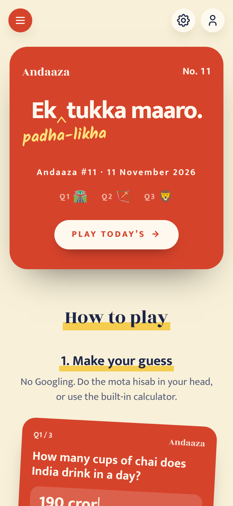<br>
      <b>1. Today's card</b><br>
      <sub>Three topics, one tap to start.</sub>
    </td>
    <td align="center" valign="top" width="33%">
      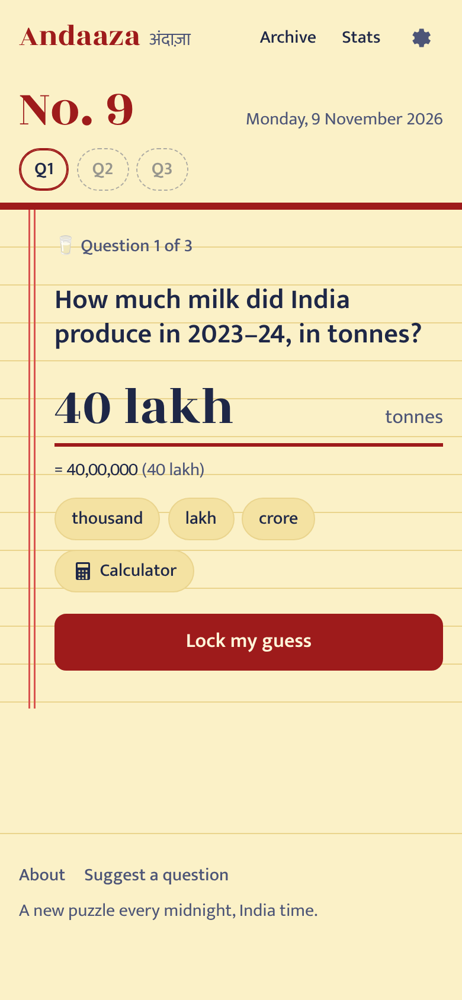<br>
      <b>2. Guess</b><br>
      <sub>Type 45000, 4.5 lakh or 2 crore. The card shows the number in full as you type.</sub>
    </td>
    <td align="center" valign="top" width="33%">
      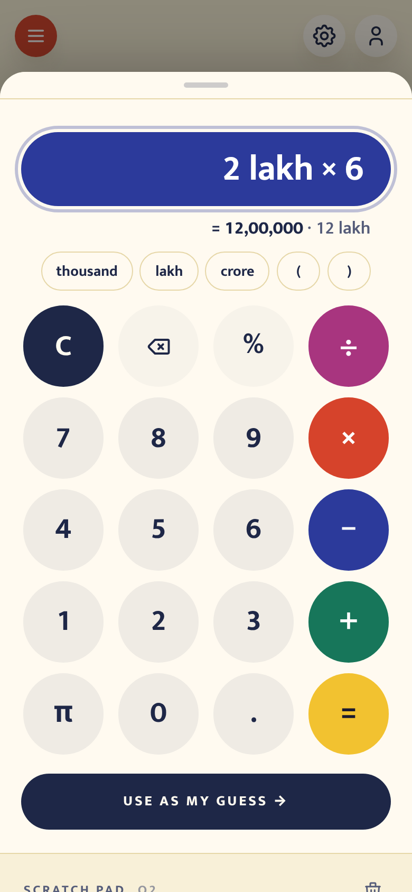<br>
      <b>3. Work it out</b><br>
      <sub>Calculator with lakh and crore keys, π, and a scratch pad for each question.</sub>
    </td>
  </tr>
  <tr>
    <td align="center" valign="top">
      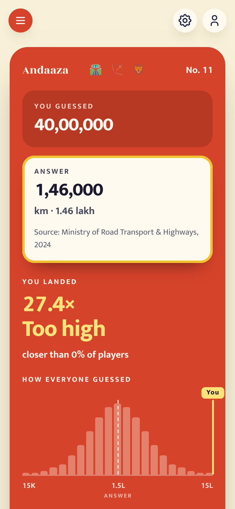<br>
      <b>4. See the answer</b><br>
      <sub>How many times off you were (1× is perfect) and where everyone else's guesses landed.</sub>
    </td>
    <td align="center" valign="top">
      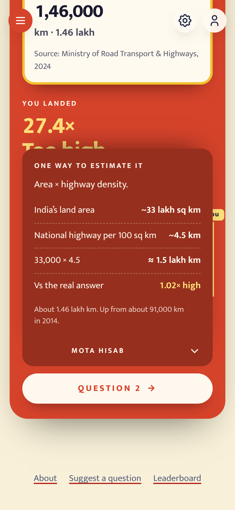<br>
      <b>5. Mota hisab</b><br>
      <sub>One way to estimate it, step by step, and how close that gets.</sub>
    </td>
    <td align="center" valign="top">
      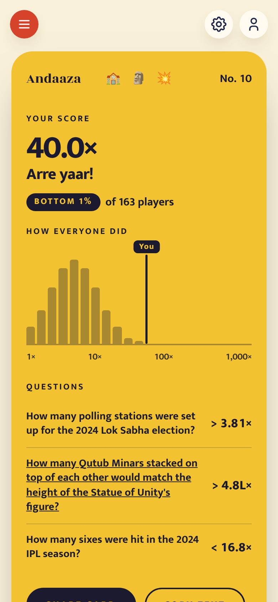<br>
      <b>6. Your score</b><br>
      <sub>The average of your three misses, your rank and the day's spread. Share it as a card or text.</sub>
    </td>
  </tr>
  <tr>
    <td align="center" valign="top">
      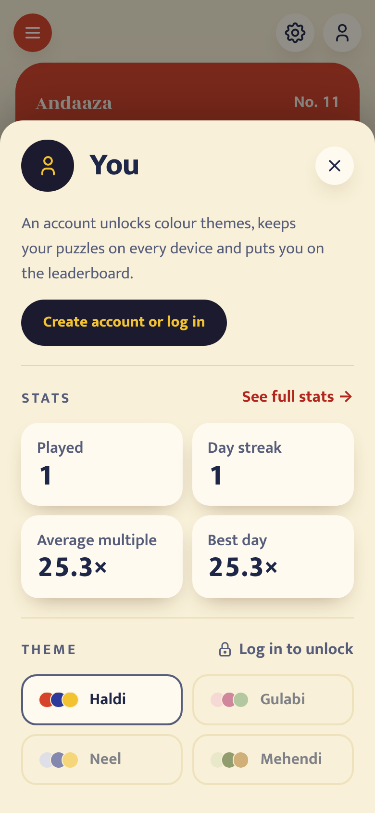<br>
      <b>You</b><br>
      <sub>Your stats, and colour themes that unlock with a free account.</sub>
    </td>
    <td align="center" valign="top">
      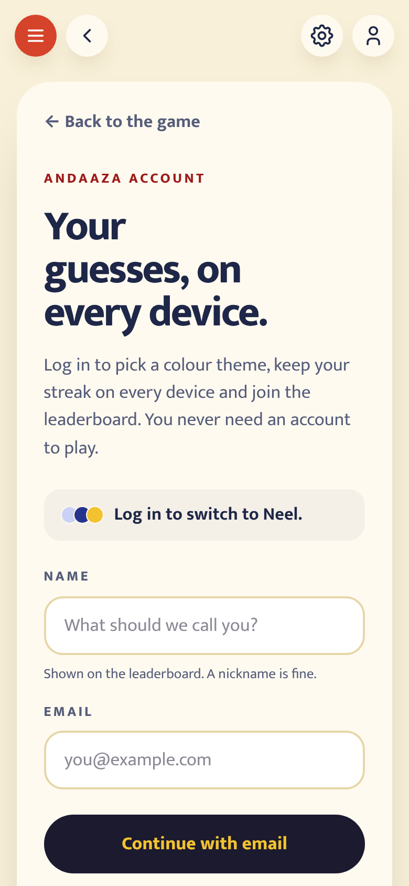<br>
      <b>Log in</b><br>
      <sub>Name and email, then a one-time link. Your theme and streak follow you to every device.</sub>
    </td>
    <td align="center" valign="top">
      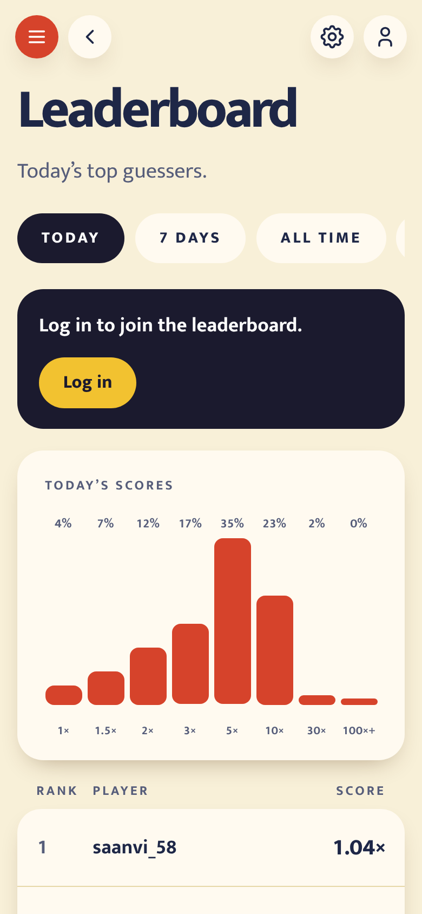<br>
      <b>Leaderboard</b><br>
      <sub>Today, the last 7 days, all time and streaks, with the day's score spread.</sub>
    </td>
  </tr>
</table>

On a laptop:

<p>
  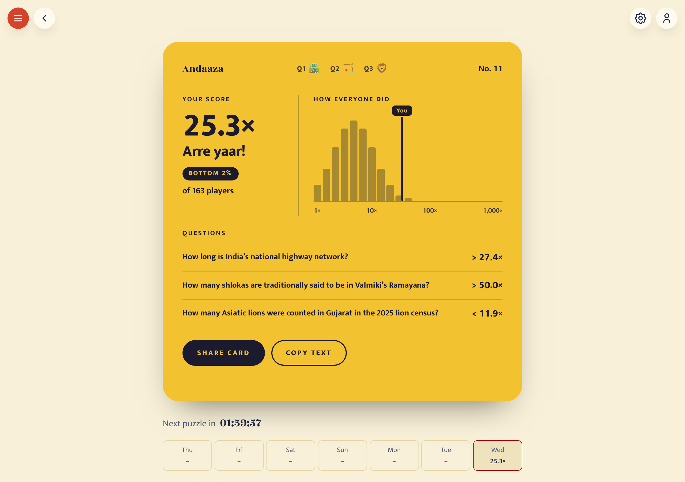
  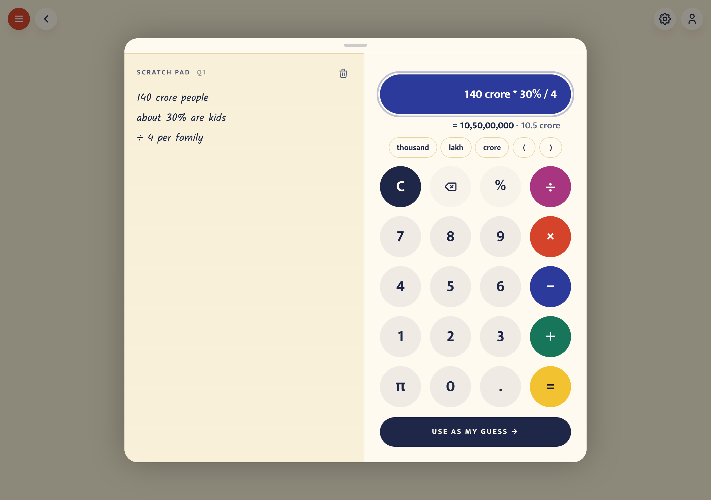
</p>

<sub>Screenshots come from `npm run test:e2e`, which fills the crowd charts and
leaderboard with sample data. More (menu, how to play, dark mode, FAQ, laptop home page) in
[`screenshots/`](screenshots/).</sub>

### Scoring

- Each guess scores how many times off it was: `max(guess / answer, answer / guess)`.
  1× is perfect, 2× means half or double.
- The day's score is the geometric mean of the three, each capped at 1,000×. Lower is better.
- The crowd charts bucket guesses on a log scale from ÷10 to ×10 of the answer, and
  day scores from 1× to 1,000×.

### Where things live

| Piece | Where |
| --- | --- |
| Scoring, verdicts, crowd buckets and ranks | `src/lib/core/score.ts` |
| Guess parsing and Indian/international number formatting | `src/lib/core/number.ts` |
| Calculator maths (safe parser, no eval) | `src/lib/core/calc.ts` |
| Daily rotation in Asia/Kolkata, puzzle numbers, countdown | `src/lib/core/date.ts` |
| Question bank (48 questions) and 16-day schedule | `src/lib/data/` |
| Game cards (intro, question, reveal, results, charts) | `src/lib/game/` |
| Panels, calculator, sheets, icons | `src/lib/components/` |
| Local persistence (`andaaza:v1:*` in localStorage) | `src/lib/state/storage.ts` |
| Online mode, accounts and sync | `src/lib/state/`, `supabase/migrations/` |

`LAUNCH_DATE` in `src/lib/core/date.ts` sets puzzle No. 1. After the 16
hand-curated days run out, a deterministic seeded rotation replays earlier
questions (marked "Rerun") until new ones are added to `SCHEDULE`.

## Adding questions

1. Add an entry to `src/lib/data/questions.ts` with answer, unit, source, year,
   confidence and a mota hisab walkthrough (the `napkin` field).
2. Add a triple of ids to the end of `src/lib/data/schedule.ts`.
3. `npm test`: the bank tests fail on a missing field, duplicate id, unscheduled
   question, or a mota hisab (the `napkin` field) that lands more than 1.5× from the answer.

## Before a public launch

- **Fact-check every answer.** Figures came from public sources known at writing
  time. Questions marked `confidence: 'medium'` (about half) especially need a fresh
  check against the named source.
- Set `LAUNCH_DATE` to the real launch day.
- Pick a domain and set `VITE_SITE_URL` so share text links to it.

## Online mode (crowd charts, leaderboard, question inbox)

Online mode is on. The "How everyone guessed" and "How everyone did" bar charts,
the "closer than X% of players" line, the leaderboard and the question inbox use a
Supabase project (`andaaza`, ref `pqvppabcdbenzrlbxzkw`, Mumbai region).

- `.env.production` holds the public project URL and **publishable** key. Both are
  meant to be public; Vercel and `npm run build:pages` pick them up automatically.
- Tables are locked behind RLS with no policies. Browsers can only call the five
  validated `andaaza_*` functions in `supabase/migrations/`, which store anonymous
  guesses (random session id, no names or emails unless a player sets a nickname).
- Histograms use 21 log-scale bins: guesses from ÷10 to ×10 of the answer, day
  scores from 1× to 1,000×.
- `npm run test:e2e` intercepts every Supabase call with canned data, so tests never
  write to the real database.

To run without a backend, delete `.env.production`; the game falls back to fully
offline play (charts show only your own marker).

Finished games that never reached the backend (played offline, or before online
mode) are sent once on the next visit, so a player's own result always shows in
the charts.

While the game is new, sample players fill the gaps (`src/lib/core/samples.ts`): each
guess and score chart is topped up to 100 entries and each leaderboard tab to 50 rows
with random names, seeded by date so everyone sees the same crowd and it reshuffles
every day. Samples step aside as real players arrive, a small note says when they're
showing, and "closer than X%" and "Top X%" only ever count real players. Set
`CHART_TARGET` and `BOARD_TARGET` to 0 to turn them off.

Test data never counts as real (`supabase/migrations/20261111170000_real_players.sql`).
That covers every game and guess recorded before launch, and every account that
existed at launch (listed in `andaaza_test_accounts`). It also covers anything played
later by those accounts, or in a browser where one of them has played. Delete a row
from `andaaza_test_accounts` to count that account again, or insert a user id to mark
another test account.

## Accounts

Playing never needs an account. Colour themes do: a guest who taps a theme goes to
`/login`, enters a name and email (or uses Google once it's switched on), and gets a
one-time link. Opening it logs them in, applies the theme they picked and unlocks the
rest. Signed-in players also get their games, theme, light/dark mode and number style
on every device, and their name on the leaderboard.

- `supabase/migrations/20261110000000_accounts.sql` (applied): `andaaza_profiles`
  (name, theme, mode, number style) and `andaaza_user_games`, both readable and
  writable only by their owner (row-level security); a trigger that creates a
  profile with the sign-up name; a leaderboard limited to signed-in players.
- Names and emails: Supabase → Authentication → Users. Names and themes:
  Table Editor → `andaaza_profiles`.
- Email delivery needs custom SMTP (Authentication → Emails). Supabase's built-in
  sender only reaches the project's own team.
- The login screen also takes the 6-digit code from the email, for links opened on
  another device. Add `{{ .Token }}` to the "Confirm signup" and "Magic Link"
  templates (Authentication → Emails → Templates) so the code is in the email.
- Opening a login link a second time no longer logs the player out; the site says
  the link was already used.
- Google: create an OAuth client in Google Cloud (redirect URI
  `https://pqvppabcdbenzrlbxzkw.supabase.co/auth/v1/callback`) and paste its ID and
  secret into Authentication → Sign In / Providers → Google. The "Continue with
  Google" button on `/login` appears by itself once it's on.
- Builds without `VITE_ACCOUNTS=1` hide all of this and leave themes open to everyone.

`node tests/e2e/accounts.mjs` runs the whole flow (locked theme, login form, email
request, coming back signed in, profile saved and restored, logging out) against
stubbed Supabase calls.

## Credits

Icons: [Tabler Icons](https://tabler.io/icons) (MIT License). The Aryabhata
illustration is an original SVG (`src/lib/components/landing/Aryabhata.svelte`);
no portrait of Aryabhata survives, so it is a stylised figure, not a likeness.
